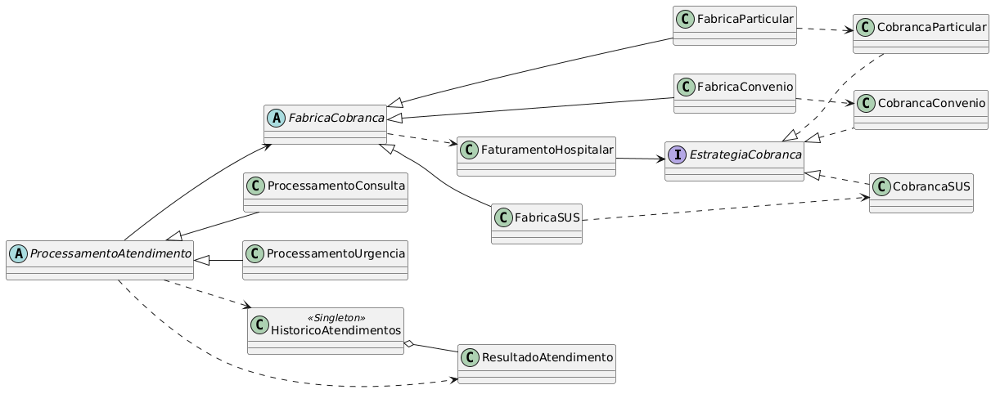

# PatternIntegrationSFmTmS

Uma implementação de integraçao dos padroes de projeto Strategy, Factory Method, Template Method e Singleton para a disciplina de Aspectos Avançados em Engenharia de Software

